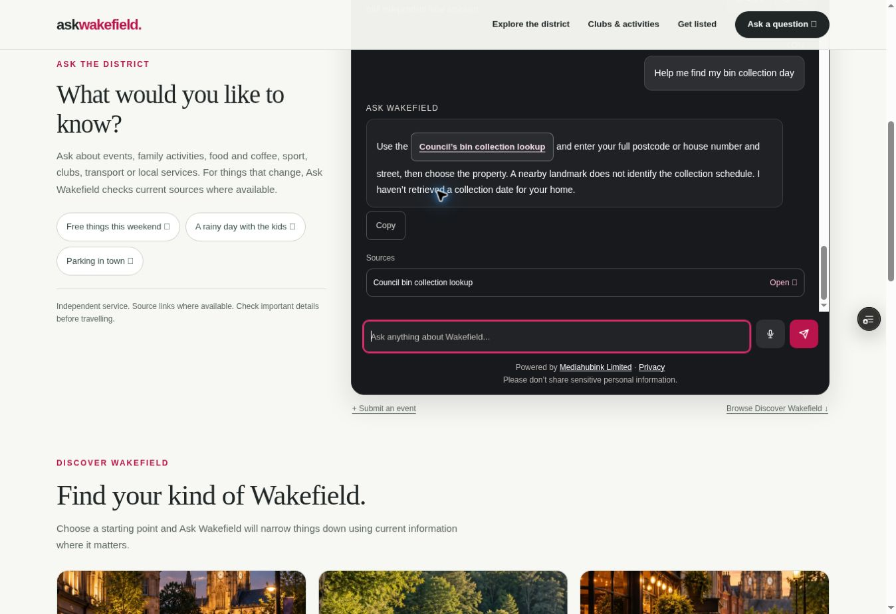

# Extensive chat review, 15 November 2026

Scope: all 12 homepage chat entry points, all 21 activity-page Ask links, the follow-up pills they return, and varied multi-turn questions covering dates, areas, price, family ages, station corrections, civic services, transport, allergy/access requirements, invented venues and reset behaviour. Tests cannot establish every possible question or every changing venue fact.

## Initial live evidence

33 initial live conversations (12 homepage starters and 21 activity-page links) completed at HTTP 200. HTTP success was not counted as content correctness. The replays exposed:

- Families bypassed the structured calendar and called 15–21 November this week, then described expired Light Up events.
- The Discover events prompt combined this week and this weekend, causing it to miss the structured weekly route and include the following week's events.
- Both Local services prompts were misread as property-specific bin questions.
- Parking navigation returned policy text with no actual source link.
- The broad rainy-day reply invented operational details without sources.
- The activities directory was disconnected from chat. Named programmes, padel and clubs were wrongly denied or replaced with unverified facility locations and Scout ages. Some initial clarifying questions were valid, but most substantive activity answers lacked sources.
- Generic follow-up questions were generated without checking that the chat could answer them. The preview callback also referred to an undefined progressTimer.
- New chat could accept an old in-flight reply and recover old state from its server cookie.

## Fixes under test

- All starter handlers are exercised from the actual HTML. The rainy-day button explicitly asks about children.
- Deterministic follow-up suggestions use a finite set of supported questions. Coffee supplies signed-context refinement pills directly.
- Follow-up callbacks no longer reference an unrelated timer. New chat invalidates old response callbacks. An explicit null stateToken prevents server-cookie recovery into a fresh chat.
- Free/low-cost family wording uses the structured calendar and verifies family suitability and free price. Explicit this-week wording takes priority over an incidental weekend mention.
- Local-services navigation asks which service and supplies relevant official links. No generic free-parking guarantee is made.
- Indoor starters provide source-linked visit ideas without asserting current sessions or hours. Existing detailed family itineraries retain their route.
- Activity Ask links now use the same programme source references as the directory. Source paragraphs are not promoted into programme-wide rules. A live replay exposed an out-of-scope swimming paragraph, so the excerpt feature was removed. Programme availability, age eligibility, prices and exact session matches remain unconfirmed unless the source text establishes them. Unknown current information is not evidence that a programme does not exist.
- Food and coffee conjunctive searches require both services. Acknowledgements preserve coffee context; ambiguous station choice retains children and seating.

Reproducible cases: tests/fixtures/chat-qa-entrypoints.json and tests/fixtures/chat-qa-conversations.json. The preview harness scripts/qa-chat-preview.py accepts its temporary URL/access configuration through stdin and does not persist credentials in results.

Final live results and remaining limits appear below.

## Further failures found by the 84-turn conversation replay

- A rainy-day follow-up could absorb a new free-weekend query rather than switching to events.
- Next Saturday escaped the structured date path and produced garbled, partially stripped prices. It now has a one-day civil-date window and retains family/free filters.
- A paragraph from a swimming page was presented without its SEND-section context. Programme excerpt quotation was removed rather than generalising that rule to every child.
- A Cathedral-to-YSP reply invented a five-minute walk, stand number and service frequency. That route now uses the checked destination travel fact with an explicit boundary around unverified operational details.
- An access/budget itinerary invented Sunday museum opening, a fully accessible route and an expired Light Up event. It now retains the hard requirements and asks for the missing visit details before claiming a complete verified plan.
- A dietary answer inferred gluten-free suitability from cuisine; a severe-allergy follow-up listed unverified plant-milk venues. Explicit dietary evidence is required, and an allergy suitability match is not inferred from vegan or plant-based labels.
- A pharmacy question near Trinity Walk widened to other towns. The area now has a geographic anchor; named supermarket pharmacy questions use the exact branch source instead of unrelated discovery cards.

These were content failures despite HTTP 200 responses. Retests follow on the corrected build. The programme source references remain a starter directory, not proof of current spaces or complete timetable coverage.

## Final verification

Verified code commit: `98e38f4fd37963e4253bb51b428ebf1e4b2a4f1b`.
Preview: https://ask-wakefield-r3wz2wpxp-joash-1034s-projects.vercel.app/#assistant (Vercel authentication applies).
Main remains unchanged. PR 13 stays draft for review.

| Phase | Conversations | Live API turns |
| --- | ---: | ---: |
| Homepage baseline | 12 | 12 |
| Activity baseline | 21 | 21 |
| First entry-point retest | 33 | 33 |
| Varied conversations and follow-up pills | 35 | 84 |
| Acceptance retest | 40 | 51 |
| Final journey replay | 1 | 3 |
| Total | 142 | 204 |

These totals include failures found during testing and subsequent retests. They are not 204 passing assertions. All calls completed at HTTP 200, but semantic review found the failures documented above. The final acceptance run exposed one remaining shorthand bus-routing failure, corrected afterwards and verified by the final three-turn replay. That replay returned local-navigation-v1, ysp-route-v1 and local-navigation-v1, retained origin/destination, and did not invent a departure, frequency, stand or walking time.

Coverage includes all 12 homepage chat buttons, all 21 activity Ask links and all 17 distinct follow-up pills observed in this test set. The conversation fixture includes 48 varied turns in 16 scenarios. The pill fixture replays each suggestion with its parent question. This establishes coverage of the actual observed controls, not every possible sentence a visitor might type.

All 26 automated test files passed on the final source. They cover calendar date boundaries, context continuity, source scope, dietary/access constraints, activity prompts, malformed requests, explicit chat reset, late replies and follow-up rendering. Run each tests/*.mjs file with Node.

Browser checks clicked all 12 homepage starters on the preceding API build. On the final build, coffee returned three relevant pills, switching to Local Services removed those pills and showed only three service suggestions, and clicking the bins pill returned the exact Council lookup. New chat cleared conversation history and an unsent draft. The final UI change also guards against late fallback suggestions from an older answer.

Live traces are stored in docs/qa-2026-11-15 without credentials or signed state tokens. Requests involving allergies, children, access needs and budgets were synthetic QA scenarios, not personal information about the project owner.

## Examples of corrected behaviour

| Trigger | Failure found | Verified correction |
| --- | --- | --- |
| Family events this week, then next Saturday | Wrong week and unsupported event/price claims | Structured Monday-Sunday interval, then Saturday 21 November only, retaining family/free filters |
| New chat during a request | Late answer could restore old conversation | Generation guard ignores old callbacks, explicit null token prevents cookie recovery |
| Coffee, then Local Services | Old coffee pills remained actionable | Only the current answer's service pills remain |
| Named activity Ask links | Real programmes denied or replaced with unsupported details | Direct programme reference and exact official link, availability clearly unconfirmed |
| Near Trinity Walk, then named supermarket pharmacy | Other-town results and store/counter confusion | Local scope retained, exact named branch reference, counter hours not inferred |
| Cathedral to YSP by bus, then last bus back | Invented walk, stand and frequency | Source-linked route fact, retained journey, exact return time explicitly unverified |
| Severe milk allergy or accessible total-budget day | Unverified suitability presented as a recommendation | Hard requirements retained, no unsupported safety/access/total-cost match |

## Remaining limits

- Activity links form a source directory. They do not establish current class spaces, timetables, prices or eligibility.
- Exact bus departures and the last return remain unverified. The answer provides the relevant official sources rather than a completed timetable plan.
- A complete accessible itinerary within a total budget still requires verified opening, route, cost and suitability matches. The current guard asks for missing details.
- Independent HAUS lookup after discovery remains outside the completed verification claims from this cycle.
- No physical iPhone or Safari testing was performed. Browser checks used the available desktop Chrome environment.
- Live source data can change. This is a substantial regression suite, not a guarantee for all future questions or facts.

## Sunday shortlist follow-up, 15 November

Joash's preview replay exposed a presentation gap: one dated Sunday event was followed by nine long runs, none with verified Sunday opening/session coverage. Added a maximum of three long runs to the weekly shortlist and an explicit opening/session caveat. A published end clock now excludes a one-day event at or after its finish in London time. Missing or ambiguous overnight clocks remain conservative. The cutoff is reapplied after detail enrichment, which can add times.

All 26 test files passed again, including new Sunday closing-boundary, BST, missing-clock, overnight-clock and long-run-count checks. A live replay at approximately 14:38 London time returned the festival, correctly still before its published 15:00 finish, plus three clearly qualified long runs and four matching source links. The after-15:00 exclusion was verified with a controlled clock, not represented as a live post-closing observation. Total live turns across this cycle are now 205.

Latest verified code: cf335aee66d6906306cf8da4bc3da49fe2ca973e.
Latest preview: https://ask-wakefield-88vgbg2lq-joash-1034s-projects.vercel.app/#assistant (Vercel authentication applies).

## Sunday next-week offer

Added the requested closing question to Sunday this-week answers, including empty lists: Would you like me to check what’s on next week? Weekday, single-day and next-week answers do not include the offer. Yes/Yes please after the offer uses the signed weekly state to open the structured next-week query and retains city/family/price filters. Verified with the weekly handler test and controlled Sunday clock.
